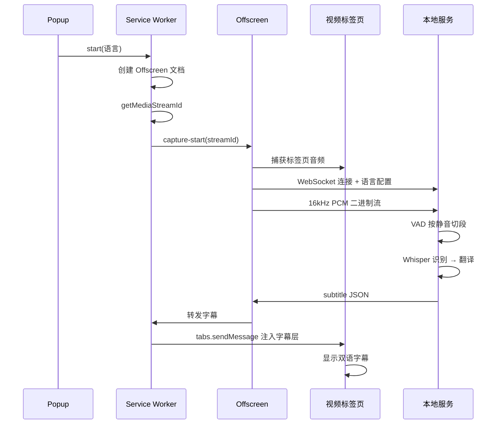

# 在线视频实时字幕翻译（OnlineTranslation）

> 在 Edge 浏览器中观看在线视频时，实时将 **日语 / 英语** 语音识别为文本并翻译成 **中文字幕** 显示。
> 采用 **方案 B：本地服务版** —— 语音识别在本机完成（faster-whisper），音频数据不出本机。

## 一、方案说明

本项目采用"浏览器扩展 + 本地 Python 服务"的架构：

| 环节 | 实现 | 说明 |
|---|---|---|
| 音频捕获 | `chrome.tabCapture` + Offscreen Document | 捕获当前标签页视频音频，AudioWorklet 重采样为 16kHz PCM |
| 语音识别 | faster-whisper（本地模型） | 支持日语 / 英语 / 自动检测，模型大小可配置 |
| 翻译 | 免费接口链（默认）/ NLLB 本地模型（可选） | 微软 Edge → MyMemory → Google 逐个回退，开箱即用 |
| 字幕显示 | Content Script 悬浮层 | 页面底部中央双语字幕，字号可调 |

**为什么选方案 B：**
- 音频全程留在本机，无隐私泄露风险；
- 无需付费 API key，识别免费；
- 复用本机 Python / GPU 环境，识别质量与速度可控。

## 二、系统架构

```mermaid
graph TD
    subgraph Edge浏览器
        A[视频标签页] -->|tabCapture| B[Offscreen Document]
        B -->|AudioWorklet 16kHz PCM| C[WebSocket ws://127.0.0.1:8765]
        D[Popup 控制面板] -->|开始/停止/语言| E[Service Worker]
        E -->|getMediaStreamId| B
        F[Content Script 字幕层] <--|chrome.tabs.sendMessage| E
    end
    subgraph 本地 Python 服务
        C -->|PCM 流| G[FastAPI WebSocket]
        G --> H[能量 VAD 分段]
        H --> I[faster-whisper 识别]
        I --> J[翻译模块]
        J -->|字幕 JSON| G
    end
    G -->|subtitle 消息| C
```

## 三、工作流程



## 四、目录结构

```
OnlineTranslation/
├── extension/                    # Edge 浏览器扩展（MV3）
│   ├── manifest.json             # 扩展清单
│   ├── background.js             # Service Worker：创建 offscreen、获取媒体流、消息转发
│   ├── offscreen.html            # Offscreen 文档页面
│   ├── offscreen.js              # 音频捕获 + WebSocket 发送
│   ├── audio-worklet.js          # 16kHz 重采样 Worklet
│   ├── content.js                # 页面字幕悬浮层
│   ├── popup.html / popup.js / popup.css  # 控制面板
│   └── icons/                    # 扩展图标（16/48/128）
├── server/                       # 本地 Python 服务
│   ├── main.py                   # FastAPI 入口 + WebSocket 端点
│   ├── asr.py                    # faster-whisper 识别封装（懒加载）
│   ├── vad.py                    # 能量型 VAD 分段
│   ├── translator.py             # 翻译抽象（google_free / nllb）
│   ├── config.py                 # 全局配置（支持环境变量覆盖）
│   └── requirements.txt          # 依赖清单
├── tools/
│   └── gen_icons.py              # 图标生成脚本（纯标准库，无需 Pillow）
└── docs/
    ├── README.md                 # 本说明文书
    ├── 安装文档.md                # 环境搭建与安装步骤
    └── 使用指南.md                # 使用与调优指南
```

## 五、技术栈

| 端 | 技术 |
|---|---|
| 扩展 | Manifest V3、tabCapture、Offscreen Document、AudioWorklet、WebSocket |
| 服务 | Python 3.12、FastAPI、uvicorn、faster-whisper、numpy |
| 翻译 | 免费接口链（微软 Edge / MyMemory / Google）/ NLLB-200（可选离线） |

## 六、通信协议（WebSocket）

**地址**：`ws://127.0.0.1:8765/ws`

**上行**（扩展 → 服务）：
- 文本消息：`{"type": "config", "lang": "ja"}`（ja / en / auto）
- 二进制消息：Float32 小端 PCM，16kHz 单声道

**下行**（服务 → 扩展）：
```json
{"type": "subtitle", "text": "原语言文本", "translated": "中文翻译", "start": 1.2, "end": 4.5, "lang": "ja"}
{"type": "error", "message": "错误信息"}
```

## 七、已知限制

1. **DRM 保护内容**：Netflix、Disney+ 等 DRM 视频音频无法捕获（静音），YouTube、B 站等不受影响；
2. **字幕为分段式**：按静音切段识别，非逐字流式，通常滞后 1~3 秒；
3. **同一时刻仅捕获一个标签页**：切换标签页后需重新点击"开始翻译"；
4. **识别精度**：CPU 上默认 `small` 模型，噪音大的视频建议换 `medium`（需更强硬件）。

## 八、快速上手

```bash
# 1. 安装并启动本地服务（详见安装文档）
call conda activate ot
python server\main.py

# 2. Edge 浏览器加载扩展（详见安装文档）
#    edge://extensions → 开发人员模式 → 加载解压缩的扩展 → 选择 extension 目录

# 3. 打开视频页面 → 点击扩展图标 → 选择语言 → 开始翻译
```

详细步骤见 [安装文档](./安装文档.md) 与 [使用指南](./使用指南.md)。
